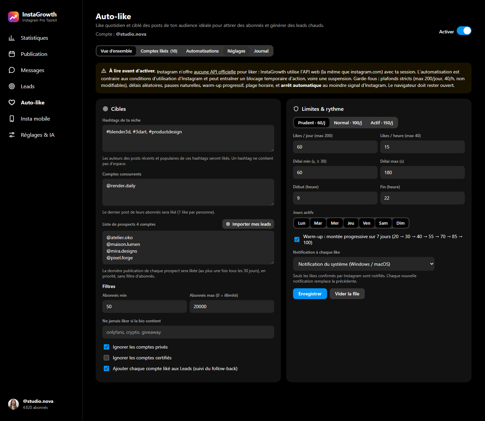

<div align="center">

**English** · [Français](README.fr.md)


# InstaGrowth

**A Chrome extension that adds growth tools right inside Instagram:**
stats and AI analysis of your posts, scheduling, leads, verified auto-like, downloads, ghost mode for stories.

[Download the latest version](../../releases/latest) · [Installation](#installation) · [Tour](#tour) · [Troubleshooting](#troubleshooting)


</div>

> The extension's interface is in French. The screenshots on this page use **demo data** (fictional accounts and numbers). The "on Instagram" views are shown on a generic mock-up, to illustrate where the extension adds its buttons.

---

## Contents

- [Installation](#installation)
- [Getting started](#getting-started)
- [Tour](#tour)
  - [Inside Instagram](#inside-instagram)
  - [Stats and recent posts](#stats-and-recent-posts)
  - [AI analysis of a post](#ai-analysis-of-a-post)
  - [Analyse another account](#analyse-another-account)
  - [Auto-like](#auto-like)
  - [Automations](#automations)
  - [Publishing and scheduling](#publishing-and-scheduling)
  - [Leads](#leads)
  - [Settings and AI](#settings-and-ai)
  - [Popup](#popup)
- [Account safety and limits](#account-safety-and-limits)
- [Troubleshooting](#troubleshooting)
- [Privacy](#privacy)
- [For developers](#for-developers)

---

## Installation

InstaGrowth is not on the Chrome Web Store: it installs in **developer mode**, in 2 minutes. It works with Chrome, Edge, Brave, Comet and any Chromium-based browser.

### 1. Download the extension

1. Open the [releases](../../releases/latest) page.
2. Under **Assets**, download `instagrowth-vX.Y.Z.zip` (the highest number).
3. **Unzip** it: right-click the zip, then "Extract all…". You get a folder containing `manifest.json`, `icons/` and `src/`.
4. Put this folder somewhere permanent, for example `Documents/InstaGrowth`. **Don't delete it**: the browser loads the extension from this folder.

### 2. Load the extension in the browser

1. Open the extensions page:
   - Chrome, Brave or Comet: type `chrome://extensions` in the address bar;
   - Edge: type `edge://extensions`.
2. Turn on **Developer mode**: the switch at the top right (in the left sidebar on Edge).
3. Click **Load unpacked**.
4. Select the unzipped folder, the one containing `manifest.json`.
5. The **InstaGrowth** card appears. Click the puzzle icon in the toolbar, then the pin next to InstaGrowth, to keep its icon visible.

> On first install, the **Réglages & IA** (Settings & AI) page opens automatically.

### 3. Update

Since v0.8.0, **InstaGrowth tells you when a new version is out**: a notification, a "MAJ" badge on its icon and a banner in the dashboard and the popup. The banner offers **Download**, **What's new** and **Reload the extension**. To install the update:

1. Download and unzip the new zip.
2. Replace the contents of your InstaGrowth folder with the new files. Your data (settings, leads, history) is kept: it is stored in the browser, not in the folder.
3. In `chrome://extensions`, click ⟳ (**Reload**) on the InstaGrowth card.
4. **Reload your Instagram tabs** (F5): pages already open keep the old version.

### Uninstall

In `chrome://extensions`, click **Remove** on the InstaGrowth card. All the extension's data is erased from the browser.

---

## Getting started

1. **Log in to Instagram** at [instagram.com](https://www.instagram.com) in this browser. InstaGrowth uses your session; it never asks for a password.
2. **Keep an instagram.com tab open**: requests go through it, exactly like the website's own.
3. **Connect an AI** in **Réglages & IA**: click **Se connecter avec Claude** (Sign in with Claude) or paste your key, or connect **OpenRouter** to use free models.
4. Fill in your **brand profile** (niche, audience, tone, offer): the AI uses it for all its suggestions.
5. On your Instagram profile, click the blue **InstaGrowth** button.

Every screen starts with a **"Comment ça marche ?"** (How does it work?) box: a 3- or 4-step mini tutorial. Collapse it when you no longer need it; it stays collapsed.

---

## Tour

### Inside Instagram


InstaGrowth blends into Instagram's interface, in its style (light or dark theme):

- **Left navigation**: an **InstaGrowth** entry opens the tools menu.
- **Your profile**: a blue **InstaGrowth** button next to "Edit profile". It gives access to Stats, Scheduling, Leads, Auto-like, Settings and **ghost mode**.
- **Other accounts' profiles**: **Analyser** (stats and AI review of the account) and **Lead** (add to your CRM) buttons.
- **Your profile grid**: hover a thumbnail and an **Analyser** button opens the AI analysis of that post.

Each tool opens in a window over Instagram, without leaving the page.


Under every post, two icons join Like, Comment and Share:

- **AI** (sparkle): **Analyse this post**, or **Suggest a comment**. The AI suggests 3 comments suited to the post, and one click inserts the one you pick into the field (you send it yourself).
- **Download** (arrow): saves the photo, every slide of a carousel or the video, in the best quality, to `Downloads/InstaGrowth/`.

In **direct messages**, an AI icon in the input area reads the latest messages and suggests 3 replies.

**Phone view** (Messages and Insta mobile tabs of the dashboard): by default, it shows Instagram in a narrow frame. The **Imiter un iPhone** (Imitate an iPhone) option gives the real mobile version, needed to post stories. It is off by default, because Instagram then sees your session on both your PC and an "iPhone", which can cause logouts.

**Story ghost mode**: once on (InstaGrowth menu, popup or Settings), you watch stories without showing up in the viewers list. A "Mode fantôme" badge is shown while watching. Only the "story seen" receipt is blocked: your messages and notifications work normally.

### Stats and recent posts


- **Key figures**: followers (7- and 30-day change, from one snapshot per day), engagement rate compared with benchmarks for your size, average likes and comments, posting frequency.
- **Recent posts**: each post with its date, format, likes, comments, views, engagement rate and **difference from your average** (green above, red below). Sort by Recent, Top or Flops, table or grid view.
- Further down: follower curve, quick diagnosis, engagement by day and hour, performance by format and caption length, hashtags, and a full **AI review** of the account (score, strengths, weaknesses, 30-day action plan, post ideas).

### AI analysis of a post


Click a post in the table, **Analyser un post** (to paste a link), or the AI button of an Instagram post. You get:

- the post's numbers **compared with your average**;
- an **AI diagnosis**: score out of 10, why it worked or not, critique of the hook and caption, hashtags and timing, **3 rewritten captions**, ideas to repurpose it (reel, story, follow-up).

### Analyse another account


In **Statistiques**, type `@name` in **Analyser un autre compte**, or click **Analyser** on their Instagram profile. Recently analysed accounts stay one click away.

- **Compare with my account**: you against this account (followers, engagement, average likes and comments, frequency, hashtags, best format, best time slot). The better value is shown in green.
- **Add to leads**: adds it to your CRM.

### Auto-like


Auto-like likes posts from your target audience every day (hashtags in your niche, followers of competitor accounts, or **your own prospect list**), to get you discovered and generate leads.

- **Overview**: today's likes against the limit, live status, next like, queue, 14-day history, last liked accounts. The **Liker maintenant** (Like now) button starts a run immediately.
- **Every like is real and verified**: it only counts once Instagram confirms it.
- **When every available account has been liked**, a message and a notification ask you to add new hashtags, competitors or prospects. The **Ajouter des comptes** (Add accounts) button takes you straight to the right place.
- **Notification on every like** option: a system notification, or a small bubble inside Instagram.



In **Auto-like → Réglages**, choose your targets: hashtags, competitor accounts, and a **prospect list** (one account per line). The **Importer mes leads** (Import my leads) button fills it with your leads. Each prospect gets at most one like every 30 days, with priority. You also set the limits, time window, active days and notifications there.


The **Comptes likés** (Liked accounts) tab lists every liked account: followers, liked post, source, date, "verified" mark, **follow-back** (followed you, not yet, to check) and lead status. Click a row to see the bio and counters. Filter by period, source and follow-back, and export to CSV.

### Automations


Rules you turn on one by one. They add priority targets to the queue, with the same caps and delays:

- **Like my new followers**: a discreet thank-you to every new follower.
- **Return likes**: like a post from people who liked your latest post.
- **VIP accounts**: like every new post from your partners, clients or influencers.
- **Nurture my leads**: regularly like your warm or contacted leads.

Each rule has its own frequency, maximum per run, a **Lancer maintenant** (Run now) button and the time of its last run. Active days and the time window are set in **Auto-like → Réglages**.

### Publishing and scheduling


- **Media**: photos, carousels (up to 10) and videos, 1:1, 4:5, 1.91:1 or original crop, reordered by drag and drop.
- **Caption**: counters (2,200 characters, 30 hashtags), **faithful preview** of the result, first comment, hashtag sets.
- **AI assistant**: 3 captions from a brief and a style, rewriting (improve, shorten, add a CTA, emojis, translate), three tiers of hashtags with their real volume.
- **Scheduling**: suggests your **best time slot** from your stats, editorial calendar, drafts. By default you get a **notification** at the planned time. Automatic photo publishing is available as an option (experimental). Reels and videos are published through **Insta mobile**.

### Leads


- **Find leads**: by hashtags or among competitors' followers (**several at once, comma-separated**), among people who liked a post, or by importing a list. Filters on followers, bio keywords, business accounts and whether an email or phone number is shown.
- **Add a lead** by hand: an @account (or its profile link), with optional name, email, phone, status and note. The rest (photo, followers, bio) is fetched automatically.
- **Bio and contacts**: fetched automatically in the background for leads that don't have them yet. The **Compléter les infos** (Fill in details) button fetches them right away.
- **Mini-CRM**: status filters with counters (New, Liked, Warm, Contacted, Replied, Won, Lost), sorting, colour-coded **AI score** out of 100, contact icons (email, phone, website), notes, bulk actions on the selection, CSV export.
- **Personalised AI outreach message** for each lead. Sending stays manual, on purpose: automated messages are the number one cause of blocks.

### Settings and AI


- **Claude (Anthropic)**: click **Se connecter avec Claude**. The Claude console opens, you create a key and click **Connecter à InstaGrowth** in the card that appears. You can also paste an `sk-ant-…` key directly. Available models: Opus 5.5 (default), Sonnet 5.5, Haiku 5.5 and Fable 5.1.
- **OpenRouter**: one-click connection (OAuth), with the list of **free models**.
- **OpenAI-compatible**: Ollama or LM Studio locally, Groq, Mistral…
- **Brand profile**, **scheduled publishing** mode, **ghost mode**, data export or reset.

### Popup


The toolbar icon shows your account, auto-like status (today's likes), ghost mode, the next scheduled post, and shortcuts to every tool.

### Several Instagram accounts

Data is **kept separate per account**: auto-like, liked accounts, automations, follower snapshots. Leads and scheduled posts belong to the account that created them, and **a post is never published on another account**.

---

## Account safety and limits

Instagram offers **no official API** to like posts, or to read hashtags or followers. InstaGrowth therefore uses instagram.com's **web API** with your session, like other tools of this kind. Built-in safeguards:

- **Strict caps** that cannot be changed: 200 likes per day, 40 per hour, at least 30 s between two likes, 180 reads per hour.
- **Presets** Careful (60 per day), Normal (100) and Active (150), with a **gradual ramp-up** over 7 days.
- **Human-like behaviour**: random delays, natural pauses, time window and active days, shuffled target order, one like per person every 30 days at most.
- **Automatic stop** at the first signal from Instagram: rate limit (2 h pause), action blocked (24 h), security check (48 h).
- Direct messages are **never sent automatically**.

> **Important.** Automation (auto-like, automatic publishing) goes against Instagram's terms of use and can lead to a temporary block or even a suspension. Use it in moderation: you remain responsible for your account. Only download content you have the right to reuse.

---

## Troubleshooting

**"Non connecté à Instagram" (not logged in) although I am logged in**
Reload the instagram.com tab and keep it open. Since v0.6.3, the extension detects the session better and recovers on its own. If needed, click **Réessayer maintenant** (Retry now).

**Instagram logs me out from time to time**
Open **Réglages & IA → Connexion Instagram**: every logout is recorded there, with the extension's actions in the 15 minutes before it. Automations pause automatically. Most common causes:
- the **Imiter un iPhone** option of the phone view: turn it off;
- bursts of requests while testing (lead searches, repeated stats): space them out;
- DevTools mobile emulation left on in the Instagram tab.

If the list shows no extension activity before the logout, it probably didn't come from the extension.

**Lead bios and contacts stay empty**
Instagram often limits the API that returns bios. The extension then fetches them in the background: a few profiles every 6 minutes, or when you open a profile on instagram.com. Click **Compléter les infos** to speed it up. Many accounts simply show no public email or phone number.

**"Instagram limite temporairement cette requête (429)"**
Instagram rate-limits some requests. The extension pauses that request for 15 minutes and uses a fallback method when one exists. Wait a little, then try again.

**"Like non confirmé par Instagram : non compté"**
The like was not recorded, so it is not counted. The log (Auto-like → Journal) shows the icons seen on the page: open an issue with that line if the problem persists. When the log says "clic sur la page" (click on the page), a pinned Instagram tab is open in the background: keep it open.

**InstaGrowth buttons don't appear on Instagram**
Reload the Instagram page (F5). If you just updated the extension, reload it too in `chrome://extensions`. Another Instagram extension (Inssist, etc.) may conflict: disable it for a moment to check.

**Stats show no posts**
Open your profile on instagram.com, wait for the posts to load, then run the analysis again. The extension also picks up posts loaded by the page.

**An error appears in `chrome://extensions`**
Click **Errors** on the InstaGrowth card, copy the message and open an [issue](../../issues).

---

## Privacy

- Everything is stored **locally in your browser**: settings, leads, history, AI keys.
- Nothing is sent anywhere except **Instagram**, through your own session, and the **AI provider** you choose.
- No InstaGrowth server, no account to create, no data collection.

---

## For developers

**Manifest V3** extension in plain JavaScript (ES modules), with no dependencies and no build step. To load it from source, clone the repository and use "Load unpacked" on the root folder.

```
manifest.json                  Manifest V3
src/background.js              service worker: auto-like engine, automations, leads, follow-backs,
                               daily snapshots, scheduling, downloads, multiple accounts
src/lib/ig.js                  Instagram web API client (every unofficial endpoint lives here)
src/lib/ai.js                  Claude / OpenRouter (OAuth PKCE) / OpenAI-compatible
src/lib/stats.js               stats and diagnostics
src/lib/limits.js              quotas and pauses
src/lib/icons.js               SVG icon set
src/lib/store.js, db.js        chrome.storage (settings) + IndexedDB (leads, posts and media)
src/app/                       dashboard (one view per tab in views/)
src/popup/                     toolbar popup
src/content/ig-ui.js           network bridge (requests from instagram.com), click-to-like, loader
src/content/ig-capture.js      (MAIN world) reads posts loaded by the page, ghost mode
src/content/inject/            Instagram integration: navigation, profile, posts, grid, DMs, window
src/content/claude-connect.js  Claude sign-in from the console
```

- Requests to the Instagram API run in the content script of an instagram.com tab: same origin, same cookies, same headers as the website.
- Auto-like runs on `chrome.alarms`, checking once a minute. It keeps going as long as the browser is open.
- Instagram changes its web API regularly. If a feature stops working, all endpoints are in `src/lib/ig.js`.
