<div align="center">


# InstaGrowth

**Extension Chrome qui ajoute des outils de croissance directement dans Instagram :**
statistiques et analyse IA de tes publications, programmation, leads, auto-like vérifié, téléchargement, mode fantôme pour les stories.

[Télécharger la dernière version](../../releases/latest) · [Installation](#installation) · [Visite guidée](#visite-guidée) · [Dépannage](#dépannage)

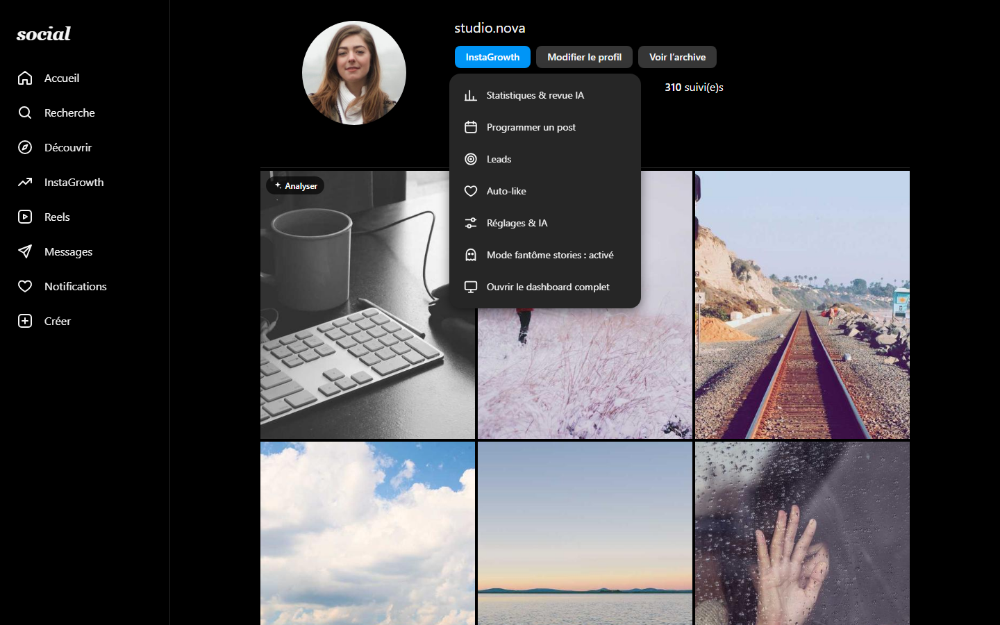

</div>

> Les captures de cette page utilisent des **données de démonstration** (comptes et chiffres fictifs). Les vues « sur Instagram » sont présentées sur une maquette générique, pour montrer où l'extension ajoute ses boutons.

---

## Sommaire

- [Installation](#installation)
- [Premiers pas](#premiers-pas)
- [Visite guidée](#visite-guidée)
  - [Dans Instagram](#dans-instagram)
  - [Statistiques et publications récentes](#statistiques-et-publications-récentes)
  - [Analyse IA d'une publication](#analyse-ia-dune-publication)
  - [Analyser un autre compte](#analyser-un-autre-compte)
  - [Auto-like](#auto-like)
  - [Automatisations](#automatisations)
  - [Publication et programmation](#publication-et-programmation)
  - [Leads](#leads)
  - [Réglages et IA](#réglages-et-ia)
  - [Popup](#popup)
- [Sécurité du compte et limites](#sécurité-du-compte-et-limites)
- [Dépannage](#dépannage)
- [Confidentialité](#confidentialité)
- [Pour les développeurs](#pour-les-développeurs)

---

## Installation

InstaGrowth n'est pas publiée sur le Chrome Web Store : elle s'installe en **mode développeur**, en 2 minutes. Ça marche avec Chrome, Edge, Brave, Comet et tout navigateur basé sur Chromium.

### 1. Télécharger l'extension

1. Ouvre la page des [releases](../../releases/latest).
2. Dans **Assets**, télécharge `instagrowth-vX.Y.Z.zip` (le numéro le plus récent).
3. **Décompresse** le fichier : clic droit sur le zip, puis « Extraire tout… ». Tu obtiens un dossier qui contient `manifest.json`, `icons/` et `src/`.
4. Range ce dossier à un endroit où il restera, par exemple `Documents/InstaGrowth`. **Ne le supprime pas** : le navigateur charge l'extension depuis ce dossier.

### 2. Charger l'extension dans le navigateur

1. Ouvre la page des extensions :
   - Chrome, Brave ou Comet : tape `chrome://extensions` dans la barre d'adresse ;
   - Edge : tape `edge://extensions`.
2. Active **Mode développeur** : l'interrupteur en haut à droite (dans la barre de gauche sur Edge).
3. Clique sur **Charger l'extension non empaquetée**.
4. Sélectionne le dossier décompressé, celui qui contient `manifest.json`.
5. La carte **InstaGrowth** apparaît. Clique sur l'icône puzzle de la barre d'outils, puis sur l'épingle à côté d'InstaGrowth, pour garder son icône visible.

> À la première installation, la page **Réglages & IA** s'ouvre automatiquement.

### 3. Mettre à jour

1. Télécharge et décompresse le nouveau zip.
2. Remplace le contenu de ton dossier InstaGrowth par les nouveaux fichiers. Tes données (réglages, leads, historique) sont conservées : elles sont stockées dans le navigateur, pas dans le dossier.
3. Dans `chrome://extensions`, clique sur ⟳ (**Recharger**) sur la carte InstaGrowth.
4. **Recharge tes onglets Instagram** (F5) : les pages déjà ouvertes gardent l'ancienne version.

### Désinstaller

Dans `chrome://extensions`, clique sur **Supprimer** sur la carte InstaGrowth. Toutes les données de l'extension sont effacées du navigateur.

---

## Premiers pas

1. **Connecte-toi à Instagram** sur [instagram.com](https://www.instagram.com) dans ce navigateur. InstaGrowth utilise ta session, aucun mot de passe n'est demandé.
2. **Garde un onglet instagram.com ouvert** : c'est par lui que passent les requêtes, exactement comme le site.
3. **Connecte une IA** dans **Réglages & IA** : clique sur **Se connecter avec Claude** ou colle ta clé, ou connecte **OpenRouter** pour utiliser des modèles gratuits.
4. Remplis ton **profil de marque** (niche, audience, ton, offre) : l'IA s'en sert pour toutes ses suggestions.
5. Sur ton profil Instagram, clique sur le bouton bleu **InstaGrowth**.

---

## Visite guidée

### Dans Instagram


InstaGrowth s'intègre à l'interface d'Instagram, dans son style (thème clair ou sombre) :

- **Navigation de gauche** : une entrée **InstaGrowth** ouvre le menu des outils.
- **Ton profil** : un bouton bleu **InstaGrowth** à côté de « Modifier le profil ». Il donne accès aux Statistiques, à la Programmation, aux Leads, à l'Auto-like, aux Réglages et au **mode fantôme**.
- **Profils des autres comptes** : boutons **Analyser** (statistiques et revue IA du compte) et **Lead** (ajout à ton CRM).
- **Grille de ton profil** : au survol d'une miniature, un bouton **Analyser** ouvre l'analyse IA de la publication.

Chaque outil s'ouvre dans une fenêtre par-dessus Instagram, sans quitter la page.

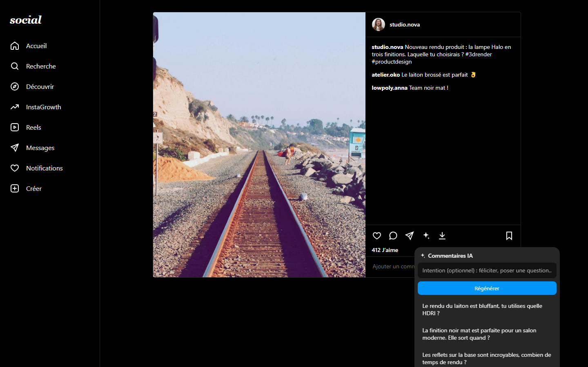

Sous chaque publication, deux icônes rejoignent J'aime, Commenter et Partager :

- **IA** (étincelle) : **Analyser ce post**, ou **Suggérer un commentaire**. L'IA propose 3 commentaires adaptés à la publication, et un clic insère celui que tu choisis dans le champ (tu l'envoies toi-même).
- **Télécharger** (flèche) : enregistre la photo, toutes les slides d'un carrousel ou la vidéo, en meilleure qualité, dans `Téléchargements/InstaGrowth/`.

Dans les **messages privés**, une icône IA dans la zone de saisie lit les derniers messages et propose 3 réponses.

**Mode fantôme stories** : une fois activé (menu InstaGrowth, popup ou Réglages), tu regardes les stories sans apparaître dans la liste des vues. Un badge « Mode fantôme » s'affiche pendant la lecture. Seul l'accusé « story vue » est bloqué : tes messages et notifications fonctionnent normalement.

### Statistiques et publications récentes

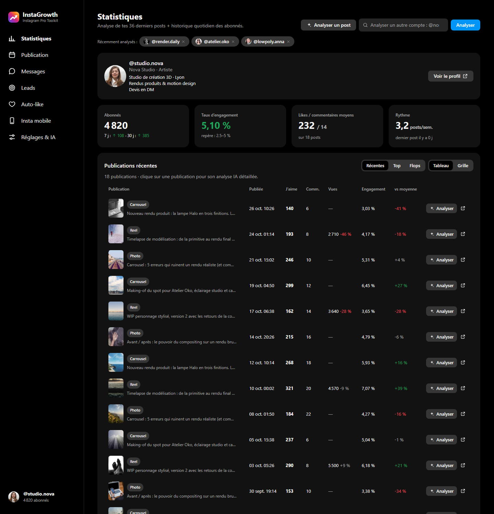

- **Chiffres clés** : abonnés (évolution sur 7 et 30 jours, à partir d'un relevé par jour), taux d'engagement comparé à des repères selon ta taille, j'aime et commentaires moyens, rythme de publication.
- **Publications récentes** : chaque publication avec sa date, son format, ses j'aime, commentaires, vues, son taux d'engagement et son **écart par rapport à ta moyenne** (en vert au-dessus, en rouge en dessous). Tri Récentes, Top ou Flops, vue tableau ou grille.
- Plus bas : courbe d'abonnés, diagnostic express, engagement par jour et par heure, performances par format et par longueur de légende, hashtags, et une **revue IA** complète du compte (note, forces, faiblesses, plan d'action sur 30 jours, idées de posts).

### Analyse IA d'une publication

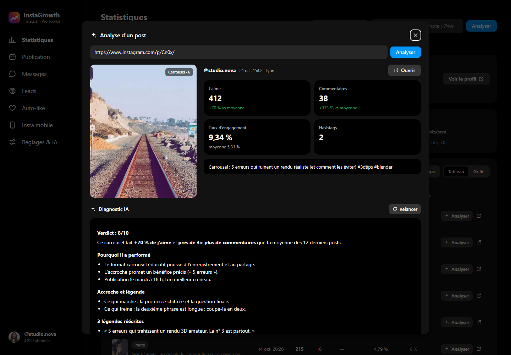

Clique sur une publication du tableau, sur **Analyser un post** (pour coller un lien), ou sur le bouton IA d'une publication Instagram. Tu obtiens :

- les chiffres de la publication **comparés à ta moyenne** ;
- un **diagnostic IA** : note sur 10, pourquoi elle a marché ou non, critique de l'accroche et de la légende, hashtags et horaire, **3 légendes réécrites**, idées pour la recycler (reel, story, suite).

### Analyser un autre compte

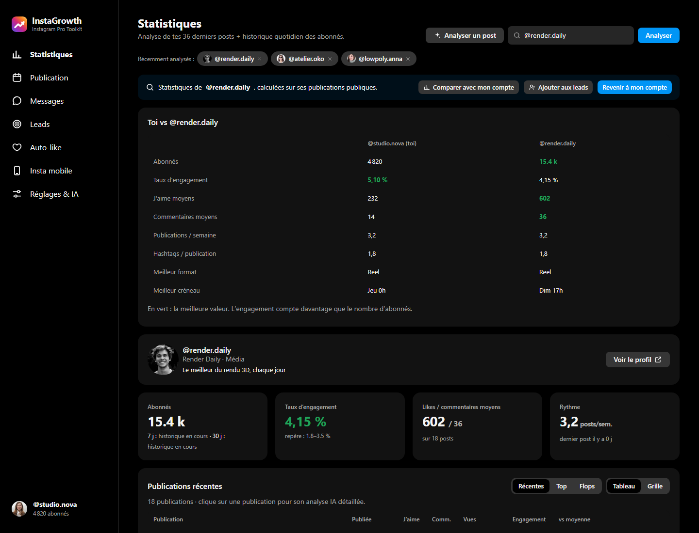

Dans **Statistiques**, tape `@nom` dans **Analyser un autre compte**, ou clique sur **Analyser** depuis son profil Instagram. Les comptes récemment analysés restent accessibles en un clic.

- **Comparer avec mon compte** : toi face à ce compte (abonnés, engagement, j'aime et commentaires moyens, rythme, hashtags, meilleur format, meilleur créneau). La meilleure valeur est en vert.
- **Ajouter aux leads** : l'ajoute à ton CRM.

### Auto-like

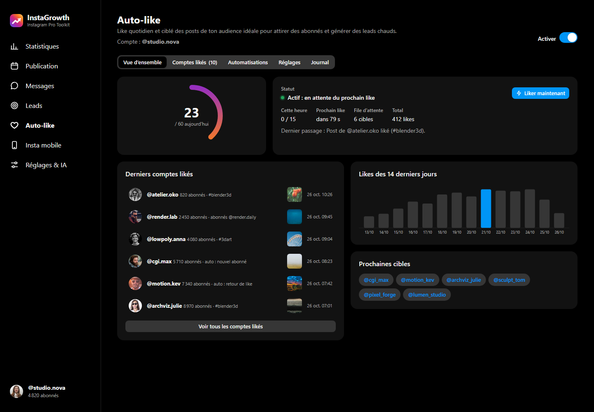

L'auto-like like chaque jour des publications de ton audience cible (hashtags de ta niche, abonnés de comptes concurrents), pour te faire découvrir et générer des leads.

- **Vue d'ensemble** : likes du jour face à la limite, statut en direct, prochain like, file d'attente, historique sur 14 jours, derniers comptes likés. Le bouton **Liker maintenant** lance un passage immédiat.
- **Chaque like est réel et vérifié** : il n'est compté que si Instagram le confirme.
- Option **Notification à chaque like** : notification du système, ou petite bulle dans Instagram.

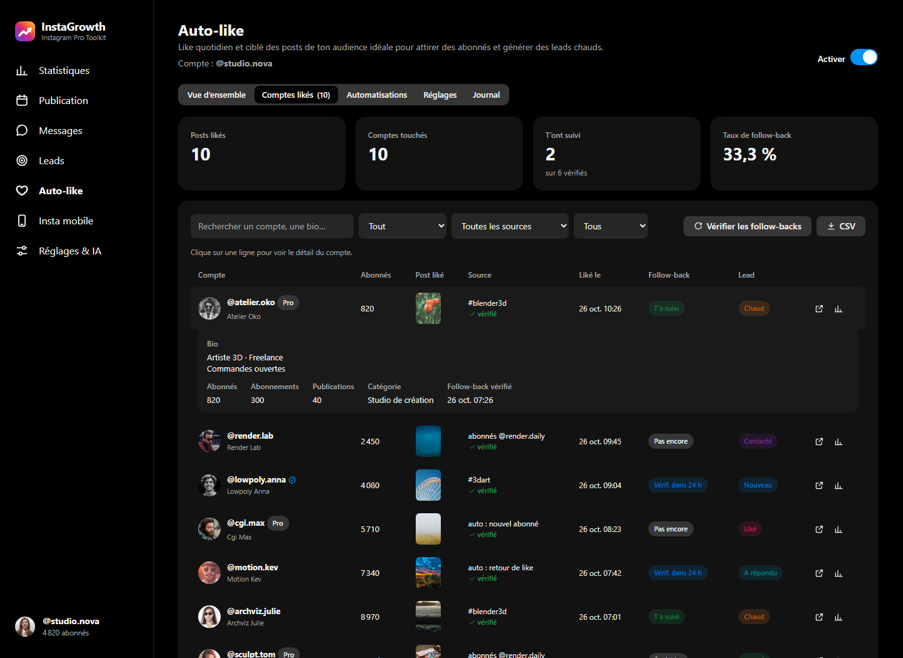

L'onglet **Comptes likés** liste chaque compte liké : abonnés, publication likée, source, date, mention « vérifié », **follow-back** (t'a suivi, pas encore, à vérifier) et statut de lead. Un clic sur une ligne affiche la bio et les compteurs. Tu peux filtrer par période, source et follow-back, et exporter en CSV.

### Automatisations

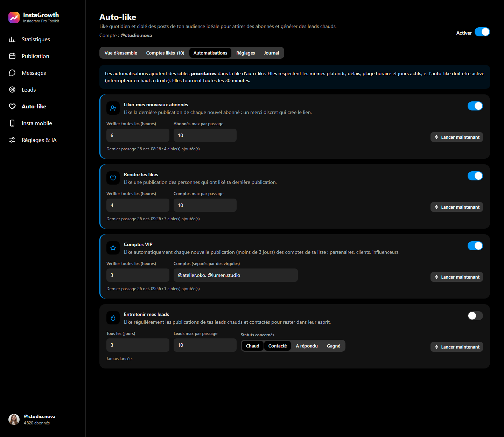

Des règles à activer une par une. Elles ajoutent des cibles prioritaires dans la file, avec les mêmes plafonds et délais :

- **Liker mes nouveaux abonnés** : un merci discret à chaque nouvel abonné.
- **Rendre les likes** : like une publication des personnes qui ont liké ta dernière publication.
- **Comptes VIP** : like chaque nouvelle publication de tes partenaires, clients ou influenceurs.
- **Entretenir mes leads** : like régulièrement tes leads chauds ou contactés.

Chaque règle a sa fréquence, son nombre maximum par passage, un bouton **Lancer maintenant** et l'heure de son dernier passage. Les jours actifs et la plage horaire se règlent dans **Auto-like → Réglages**.

### Publication et programmation

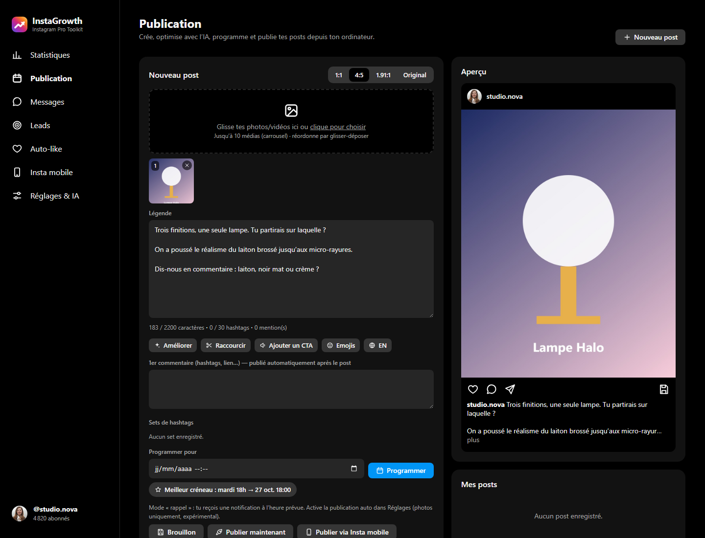

- **Médias** : photos, carrousels (jusqu'à 10) et vidéos, recadrage 1:1, 4:5, 1.91:1 ou original, réordonnables par glisser-déposer.
- **Légende** : compteurs (2 200 caractères, 30 hashtags), **aperçu fidèle** du rendu, premier commentaire, sets de hashtags.
- **Assistant IA** : 3 légendes à partir d'un brief et d'un style, réécriture (améliorer, raccourcir, ajouter un CTA, des emojis, traduire), hashtags sur trois niveaux avec leur volume réel.
- **Programmation** : suggestion de ton **meilleur créneau** d'après tes statistiques, calendrier éditorial, brouillons. Par défaut, tu reçois une **notification** à l'heure prévue. La publication automatique des photos est disponible en option (expérimentale). Les reels et vidéos se publient via **Insta mobile**.

### Leads

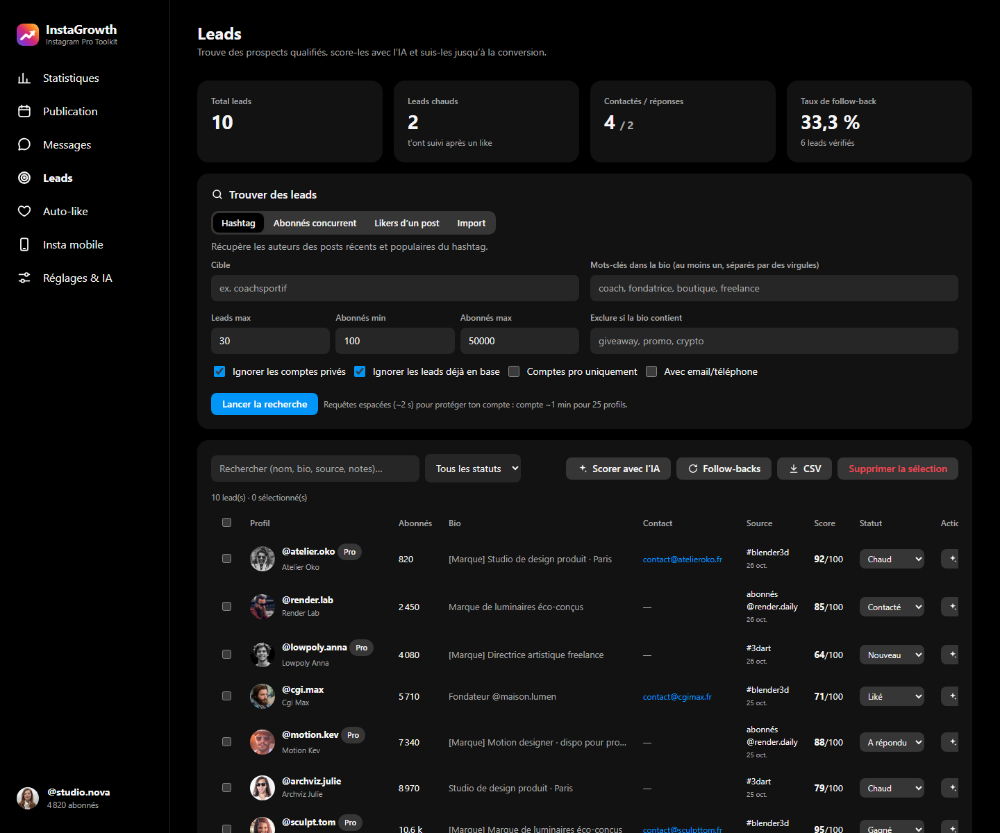

- **Trouver des leads** : par hashtag, parmi les abonnés d'un concurrent, les personnes qui ont liké une publication, ou en important une liste. Filtres sur les abonnés, les mots-clés de la bio, les comptes pro et la présence d'un email ou d'un téléphone.
- **Mini-CRM** : statut (Nouveau, Liké, Chaud, Contacté, A répondu, Gagné, Perdu), **score IA** sur 100, contacts extraits de la bio, notes, export CSV.
- **Message d'approche IA** personnalisé pour chaque lead. L'envoi reste manuel, volontairement : les messages automatiques sont la première cause de blocage.

### Réglages et IA

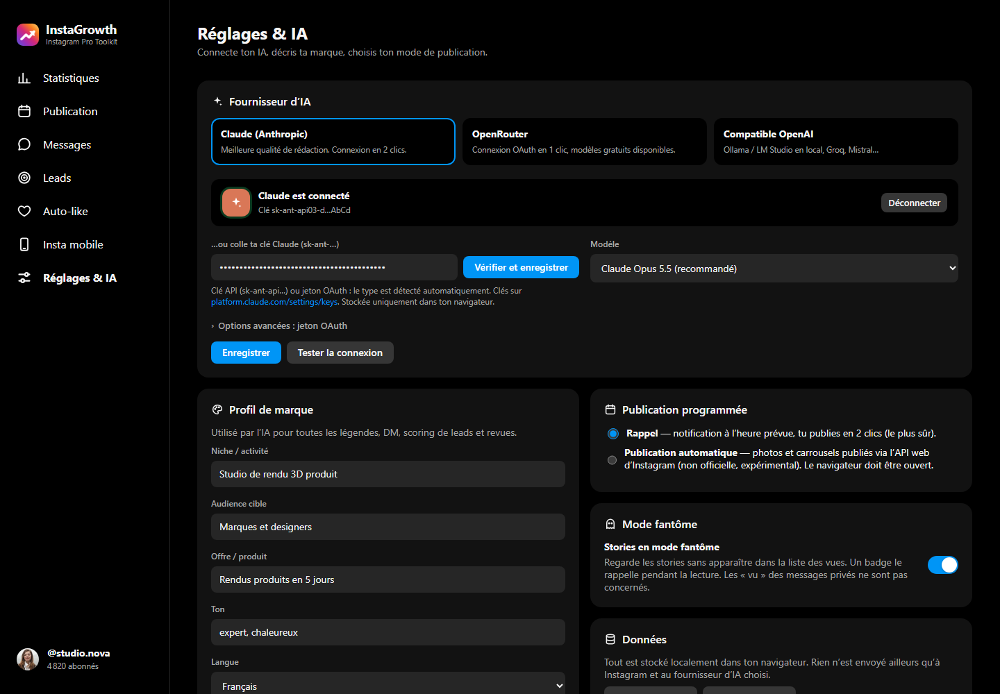

- **Claude (Anthropic)** : clique sur **Se connecter avec Claude**. La console Claude s'ouvre, tu crées une clé et tu cliques sur **Connecter à InstaGrowth** dans la carte qui apparaît. Tu peux aussi coller directement une clé `sk-ant-…`. Modèles proposés : Opus 5.5 (par défaut), Sonnet 5.5, Haiku 5.5 et Fable 5.1.
- **OpenRouter** : connexion en un clic (OAuth), avec la liste des **modèles gratuits**.
- **Compatible OpenAI** : Ollama ou LM Studio en local, Groq, Mistral…
- **Profil de marque**, mode de **publication programmée**, **mode fantôme**, export ou remise à zéro des données.

### Popup

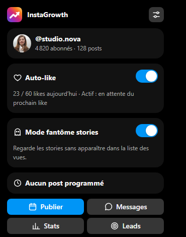

L'icône de la barre d'outils affiche ton compte, l'état de l'auto-like (likes du jour), le mode fantôme, le prochain post programmé, et des raccourcis vers chaque outil.

### Plusieurs comptes Instagram

Les données sont **séparées par compte** : auto-like, comptes likés, automatisations, relevés d'abonnés. Les leads et les posts programmés sont rattachés au compte qui les a créés, et **un post n'est jamais publié sur un autre compte**.

---

## Sécurité du compte et limites

Instagram ne propose **aucune API officielle** pour liker, ni pour lire les hashtags ou les abonnés. InstaGrowth utilise donc l'**API web** d'instagram.com avec ta session, comme les autres outils de ce type. Garde-fous intégrés :

- **Plafonds stricts**, non modifiables : 200 likes par jour, 40 par heure, 30 s minimum entre deux likes, 180 lectures par heure.
- **Préréglages** Prudent (60 par jour), Normal (100) et Actif (150), avec une **montée en charge progressive** sur 7 jours.
- **Comportement humain** : délais aléatoires, pauses naturelles, plage horaire et jours actifs, ordre des cibles mélangé, un seul like par personne sur 30 jours.
- **Arrêt automatique** au moindre signal d'Instagram : limite de requêtes (pause de 2 h), action bloquée (24 h), vérification de sécurité (48 h).
- Les messages privés ne sont **jamais envoyés automatiquement**.

> **Important.** L'automatisation (auto-like, publication automatique) va à l'encontre des conditions d'utilisation d'Instagram et peut entraîner un blocage temporaire, voire une suspension. Utilise-la avec modération : tu restes responsable de ton compte. Télécharge uniquement des contenus que tu as le droit de réutiliser.

---

## Dépannage

**« Non connecté à Instagram » alors que je suis connecté**
Recharge l'onglet instagram.com et laisse-le ouvert. Depuis la v0.6.3, l'extension détecte mieux la session et reprend toute seule. Si besoin, clique sur **Réessayer maintenant**.

**« Instagram limite temporairement cette requête (429) »**
Instagram limite certaines requêtes. L'extension se met en pause sur cette requête pendant 15 minutes et passe par une méthode de secours quand elle existe. Attends un peu, puis réessaie.

**« Like non confirmé par Instagram : non compté »**
Le like n'a pas été enregistré, il n'est donc pas compté. Le journal (Auto-like → Journal) indique les icônes vues sur la page : ouvre une issue avec cette ligne si le problème persiste. Quand le journal indique « clic sur la page », un onglet Instagram épinglé est ouvert en arrière-plan : laisse-le ouvert.

**Les boutons InstaGrowth n'apparaissent pas sur Instagram**
Recharge la page Instagram (F5). Si tu viens de mettre à jour l'extension, recharge-la aussi dans `chrome://extensions`. Une autre extension Instagram (Inssist, etc.) peut entrer en conflit : désactive-la un moment pour vérifier.

**Les statistiques n'affichent aucune publication**
Ouvre ton profil sur instagram.com, attends que les publications s'affichent, puis relance l'analyse. L'extension récupère aussi les publications chargées par la page.

**Une erreur s'affiche dans `chrome://extensions`**
Clique sur **Erreurs** sur la carte InstaGrowth, copie le message et ouvre une [issue](../../issues).

---

## Confidentialité

- Tout est stocké **localement dans ton navigateur** : réglages, leads, historique, clés d'IA.
- Rien n'est envoyé ailleurs qu'à **Instagram**, via ta propre session, et au **fournisseur d'IA** que tu choisis.
- Aucun serveur InstaGrowth, aucun compte à créer, aucune collecte de données.

---

## Pour les développeurs

Extension **Manifest V3** en JavaScript natif (modules ES), sans dépendance ni étape de build. Pour la charger depuis les sources, clone le dépôt puis utilise « Charger l'extension non empaquetée » sur le dossier racine.

```
manifest.json                  Manifest V3
src/background.js              service worker : moteur d'auto-like, automatisations, leads, follow-backs,
                               relevés quotidiens, programmation, téléchargements, comptes multiples
src/lib/ig.js                  client de l'API web Instagram (tous les endpoints non officiels sont ici)
src/lib/ai.js                  Claude / OpenRouter (OAuth PKCE) / compatible OpenAI
src/lib/stats.js               calcul des statistiques et diagnostics
src/lib/limits.js              quotas et pauses
src/lib/icons.js               jeu d'icônes SVG
src/lib/store.js, db.js        chrome.storage (réglages) + IndexedDB (leads, posts et médias)
src/app/                       dashboard (une vue par onglet dans views/)
src/popup/                     popup de l'icône
src/content/ig-ui.js           pont réseau (requêtes depuis instagram.com), like par clic, chargeur
src/content/ig-capture.js      (monde MAIN) lecture des publications chargées par la page, mode fantôme
src/content/inject/            intégration dans Instagram : navigation, profil, publications, grille, DM, fenêtre
src/content/claude-connect.js  connexion Claude depuis la console
```

- Les requêtes vers l'API Instagram sont exécutées par le content script d'un onglet instagram.com : même origine, mêmes cookies, mêmes en-têtes que le site.
- L'auto-like tourne sur `chrome.alarms`, à raison d'une vérification par minute. Il continue tant que le navigateur est ouvert.
- Instagram modifie régulièrement son API web. Si une fonction cesse de marcher, les endpoints sont tous dans `src/lib/ig.js`.
